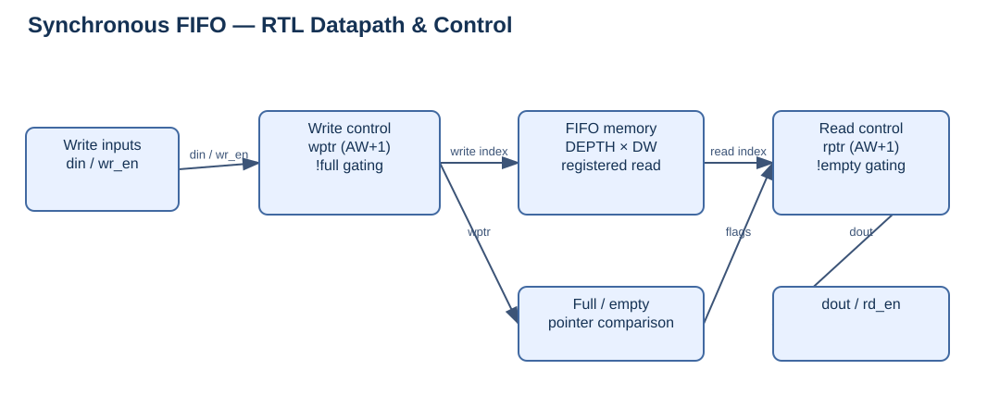
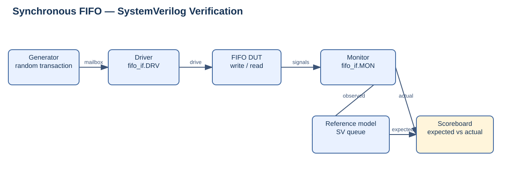

# Synchronous FIFO — Verilog RTL & SystemVerilog Verification

A parameterized, single-clock **first-in, first-out (FIFO)** RTL design and a **class-based SystemVerilog (non-UVM)** verification testbench. This repository retains the supplied source code without unverified functional changes.

> **Verification status:** Source files have been reviewed but **not simulated** as part of this repository preparation. Pass counts and coverage percentages are not claimed.

## Design overview

- **Data width (`DW`):** 16 bits (default)
- **Depth (`DEPTH`):** 8 entries (default)
- **Address bits (`AW`):** `$clog2(DEPTH)` (default 3)
- **Clocking:** single rising-edge clock (`clk`)
- **Reset:** active-low `rstn`, **synchronously sampled** at `posedge clk`
- **FIFO storage:** `mem[0:DEPTH-1]`
- **Pointers:** `(AW+1)`-bit write and read pointers; extra MSB tracks wraparound
- **Write:** accepted on `wr_en && !full`
- **Read:** accepted on `rd_en && !empty`, with registered `dout`
- **Empty:** `wptr == rptr`
- **Full:** pointer low bits equal and wrap bits different
- **Simultaneous read/write:** both operations can execute in one clock when allowed by the **pre-edge** `full`/`empty` flags

The pointer-index implementation assumes a **power-of-two DEPTH**, and the design does not implement first-word fall-through or an occupancy-count output.

## Block diagrams

### FIFO datapath and control



[Editable draw.io source](docs/fifo_rtl_architecture.drawio)

### Class-based verification environment



[Editable draw.io source](docs/fifo_verification_architecture.drawio)

## Verification structure

The SystemVerilog testbench contains:

- `fifo_if`: driver and monitor clocking blocks (`drv_cb`, `mon_cb`), and modports
- `transaction`: randomized `wr_en`, `rd_en`, `din`; constraint excludes both enables being low
- `generator`: generates transactions using a mailbox and driver-completion event
- `driver`: initializes/reset signals and drives transactions
- `monitor`: captures DUT interface samples and sends them to the reference model
- `ref_model`: queue-based behavioral FIFO and predicted `dout`, `full`, `empty`
- `scoreboard`: four-state compares predicted versus observed values (`===`)
- `environment`: creates and connects the above components
- `tb_fifo`: 10 ns clock period, DUT instance and environment; requests 30 transactions

**Coverage:** The uploaded testbench uses constrained randomization, but **does not include a SystemVerilog covergroup or assertion-based coverage**. Do not describe this version as having functional coverage closure.

## Repository tree

```text
.
├── rtl/
│   └── dut.v
├── tb/
│   └── tb_fifo.sv
├── sim/
│   └── questa.do
├── docs/
│   ├── fifo_rtl_architecture.drawio
│   ├── fifo_rtl_architecture.svg
│   ├── fifo_verification_architecture.drawio
│   └── fifo_verification_architecture.svg
├── .gitignore
└── README.md
```

## Run in Questa / ModelSim

Use a simulator supporting **SystemVerilog classes, random constraints, mailboxes and clocking blocks**. From the repository root:

```tcl
vlib work
vlog -sv rtl/dut.v tb/tb_fifo.sv
vsim -c tb_fifo
run -all
quit -f
```

Or execute `vsim -do sim/questa.do` from the repository root. Depending on your simulator, you may need to configure a time scale. The testbench emits a VCD file (`fifo_tb.vcd`), excluded from Git.

## Review notes and planned improvements

1. **End-of-test synchronization:** `post_test()` uses `wait(gen.drv_done.triggered)`. That event can be missed depending on delta-cycle scheduling; the summary may hang or run before the last transaction has been checked. Prefer an explicit generator-completed event and wait for a known scoreboard comparison count.
2. **Sampling alignment:** Monitor sampling, reference-model update order, and scoreboard comparison should be checked against NBA scheduling for back-to-back operations, especially simultaneous read/write.
3. **Random constraints:** The current `valid_c` intentionally excludes idle cycles. Dedicated scenarios for idle operation, full/empty behavior, reset during traffic, overflow/underflow attempts, and pointer wraparound should be added.
4. **Depth requirement:** Pointer indexing with `AW` low bits requires a power-of-two depth unless address wrapping logic is changed.
5. **Verification evidence:** Add actual simulation logs, waveform images, regression details and functional coverage only after running and verifying them.

## Status

This is a **portfolio source snapshot**, not a simulator-validated release. The RTL and testbench remain close to the originals so changes can be traced in subsequent commits.